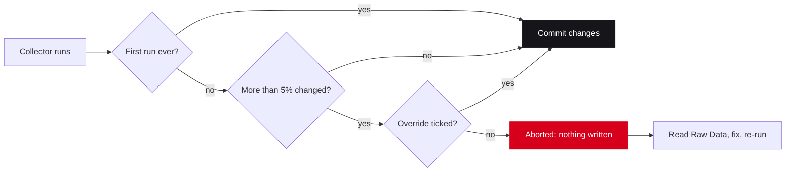

Topic 2 of 8

# Collectors

How data gets in, and what happens when it goes wrong.

<Trail :at="2" />

---
transition: slide-left
---

# Collectors: the order matters

1<b>Identities</b>IDC, from directories

2<b>Accounts</b>ADC, mapped to users

3<b>Entitlements</b>EDC, attached to accounts

Role (RDC)Data accessApplication metadata

Run on a schedule or on demand, from a native source or a flat file.

---

# Directories and applications

<h3>Directories</h3>Hold identities. Can supply identities, accounts and entitlements.

<h3>Applications</h3>Never hold identities. Accounts and entitlements only.

<h2 class="mt-5">Lab 1.2: what Prestige started with</h2>

<b>191</b>users

<b>2</b>directories

<b>3</b>business units

<b>9</b>applications

Business units <b>APJ, America, EMEA</b> are spelled exactly as in the HR file.

---
transition: rsa-flip
---

# Unification: many sources, one person

<b>AD identities</b>Email

<b>HR identities</b>Business Unit

<b>Unification</b>Joined on User ID

<b>One master record</b>Per person

<ul class="mt-8">
<li>Attribute sources choose which source wins per attribute</li>
<li>Always run it right after identity collection</li>
</ul>

---
transition: rsa-slash
---

# The circuit breaker

Default threshold: <b>5%</b>. An abort is information, not an error.

---

# Try the lab's four situations

Pick a preset, then move the slider.

Watch **when** the breaker fires, and **what** lets a run through.

<CircuitBreaker />

---
transition: rsa-flip
---

# Lab 1.3: the run that aborted on purpose

<b>Collect identities</b>AD and HR together

<b>Aborted</b>100% changed

<b>Raw Data</b>Emails show place names

<b>Fix</b>Map Email to <code>mail</code>

<b>Re-run</b>Override ticked

<h3>Root cause</h3>AD mapped attribute <code>l</code> (location) to Email Address. HR is authoritative for location.

<h3>Result</h3>AD run: 0 changes. HR run: 190 changes, the new business units. Override was justified.

---

# Lab: accounts and entitlements

| Application | Accounts | Entitlements | Orphans |
|---|---|---|---|
| Aveksa | 5 | 366 | 0 |
| Great Plains | 200 | 10 | 4 |
| Payroll | 189 | 25 | 0 |
| RACF | 196 | 65 | 7 |
| SAP | 184 | 17,949 | 0 |

<h3>Do first</h3>AD certificate selected, connection tested

<h3>Then</h3>Collect accounts and entitlements together

<h3>Also</h3>Descriptions imported before any review

---
transition: rsa-slash
---

# Multi-app collectors

Concur, 22

GitHub, 38

Projects, 38

Workday, 24

&rarr;

<h3>MAADC</h3>122 accounts and mappings

<h3>MAEDC</h3>19 entitlements, 9 resources, 322 relationships

Eight collectors became two. The only extra setting is the <code>Application</code> column.
