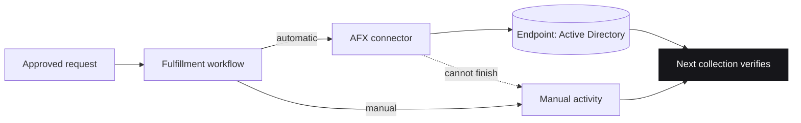

<div class="part">Topic 7 of 8</div>

# Requests and fulfillment

<p>Access Request Manager decides and tracks. AFX applies the change.</p>

<Trail :at="7" />

---
transition: slide-left
---

# The change request lifecycle

<div class="flow mt-6">
<div><span class="n">1</span><b>Submit</b>User, review, or rule</div>
<div><span class="n">2</span><b>Approve</b>By workflow</div>
<div><span class="n">3</span><b>Fulfill</b>Manual or AFX</div>
<div class="hot"><span class="n">4</span><b>Verify</b>Next collection</div>
</div>
<div class="loopback">Pending Verification until collection sees the change</div>

<div class="mt-6">
<span class="tag">Request workflow</span><span class="tag">Approval workflow</span><span class="tag">Fulfillment workflow</span><span class="tag">Escalation workflow</span>
</div>

---

# Fulfillment: who applies the change



<div class="note">Great Plains had no AFX connector, so its revoke became a manual task.</div>

---
transition: rsa-slash
---

# Lab: ARM groundwork

<div class="flow mt-6">
<div><span class="n">1</span><b>Workflow</b>One-Level Approver, not No-Approvals</div>
<div><span class="n">2</span><b>AFX servers</b>Both Running</div>
<div><span class="n">3</span><b>Connector</b>Test to Active, then test settings</div>
<div class="hot"><span class="n">4</span><b>Bind to AD</b>AFX Connector Binding</div>
</div>

<div class="note mt-8">The AD connector has no Register New User command, only <b>Create an Account</b>, which needs 8 attributes.</div>

---

# Naming policies: unique IDs

<div class="flow mt-6">
<div><b>Joe Smith</b>First and last name</div>
<div><b>jsmith</b>First initial + last name, lowercase</div>
<div class="hot"><b>jsmith2</b>If jsmith is taken</div>
</div>

```js
return firstName.toLowerCase().substr(0, 1) + lastName.toLowerCase();
```

<div class="note">Two policies: <code>Account_id_np</code> for User ID, <code>email_np</code> for email.</div>

---
transition: rsa-zoom
---

# The Register New User form

<div class="flow mt-6">
<div><b>Requestor types</b>First and last name only</div>
<div><b>Naming policies</b>Account ID and email, hidden</div>
<div><b>Register User command</b>Hidden field</div>
<div class="hot"><b>AFX</b>Create an Account in AD</div>
</div>

<div class="mt-6">
<span class="tag r">Visible: fname, lname</span><span class="tag">Hidden: Account_ID</span><span class="tag">Hidden: Email</span><span class="tag">Hidden: RegisterUser</span>
</div>

<div class="note">Mappings are case and character sensitive. The next slide shows why.</div>

---
transition: rsa-flip
---

# The request that never completed

<div class="flow mt-4">
<div><b>AFX</b>Reports success</div>
<div><b>AD</b>User exists</div>
<div><b>Collector</b>Picks it up</div>
<div class="bad"><b>Request</b>Stuck in Pending Verification</div>
</div>

<div class="grid grid-cols-2 gap-4 mt-6">
<div>

```text
sent:      ...,<space>CN=TrainingDemo,...
collected: ...,CN=TrainingDemo,...
```
</div>
<div class="card r"><h3>Root cause</h3>An extra space in the form mapping. AD dropped it, so the watch never matched.</div>
</div>

<div class="note">Fix: remove the space, revert the old request, collect again. New request: Completed.</div>

---

# Lab: a group with no account yet

<div class="flow mt-6">
<div><span class="n">1</span><b>Request</b>HR group for Sarah Pryer</div>
<div><span class="n">2</span><b>Approval skipped</b>Requestor is her supervisor</div>
<div class="hot"><span class="n">3</span><b>Indirect item</b>Create Account first</div>
<div><span class="n">4</span><b>Add to group</b>Then collect</div>
</div>

<div class="note mt-8">Setting Entitlements Require Account to <b>Always</b> makes G&L create the missing account for you.</div>